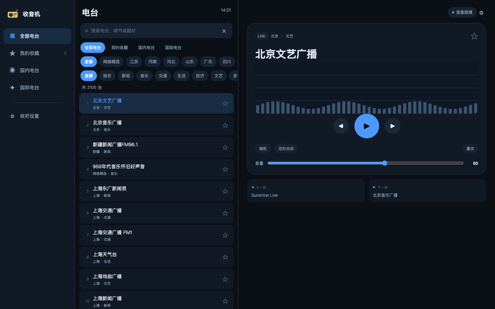

# 鸿蒙收音机

基于 **HarmonyOS ArkTS 原生**开发的平板网络收音机，参考 `youdao-tinglibao-e6` 中的 radio 示例实现，针对大屏重新设计了布局与交互。内置 2105 个网络电台，列表数据静态编译进 HAP，启动即可浏览，无需联网拉取台单。



> 真机截图：[横屏](preview/device_screenshot.jpeg) · [竖屏播放页](preview/screenshot_portrait.png) · [可交互 HTML 预览](preview/index.html)

## 功能

| 模块 | 说明 |
| --- | --- |
| 电台库 | 2105 个电台，静态数据分片为 4 个 ArkTS 模块；支持名称／省市／题材搜索 |
| 筛选 | 范围（全部／收藏／国内／国际）+ 省市胶囊 + 题材胶囊，多维叠加，选中态实时高亮 |
| 收藏 | 收藏夹、任意列表内一键收藏，持久化保存 |
| 播放 | 系统 `AVPlayer` 直连网络流；播放／暂停／停止、音量调节、上一台／下一台、顺序／随机切台 |
| 容错 | 播放失败时在 `http` / `https` 备用线路间自动重试一次；明文流由网络安全配置放行 |
| 频谱 | Canvas 绘制 4 种样式（频谱柱／LED 点阵／声波／电平表）× 4 套配色（彩虹／灰白／赛博／琥珀） |
| 定时 | 睡眠定时 0 / 15 / 30 / 60 / 90 分钟，倒计时显示 |
| 记忆 | `@ohos.data.preferences` 保存收藏、上次收听电台、音量、样式、配色、随机模式 |
| 适配 | ≥1000vp 三栏（导航／列表／播放器），680–1000vp 紧凑三栏，<680vp 单栏 + 底部页签；竖屏播放页自顶部纵向铺满 |
| 资源 | 深色主题、中文／英文文案、应用与启动图标 |

## 环境要求

- **DevEco Studio** 及配套 SDK：`compatibleSdkVersion 6.1.1(24)`，`targetSdkVersion 26.0.0`，`runtimeOS: HarmonyOS`
- **设备**：`tablet` / `phone`，HarmonyOS 6.1.0 及以上，已开启开发者模式与 USB 调试
  （已在 HUAWEI MatePad Mini 悦读版 MLR-AL00 / API 24 上真机验证）
- **网络**：应用声明 `ohos.permission.INTERNET`；播放需要可访问电台流地址的网络
- **工具脚本**：Python 3（数据导出／图标生成）、Bash（无线调试脚本）；DevEco 自带 Node 用于命令行构建

## 快速开始

1. 克隆仓库并用 DevEco Studio 打开工程根目录。
2. **配置签名**：`File → Project Structure → Signing Configs` 勾选自动生成签名。
   仓库中的 `build-profile.json5` 刻意将 `signingConfigs` 留空（不含任何证书与密码），**未签名无法安装到真机**。
3. 连接设备或启动模拟器，点击 Run。首次编译会同步 `oh_modules` 依赖。

命令行编译（macOS，路径按本机 DevEco 安装位置调整）：

```bash
cd hongmeng-shouyinji
export DEVECO_SDK_HOME="/Applications/DevEco-Studio.app/Contents/sdk"
export JAVA_HOME="/Applications/DevEco-Studio.app/Contents/jbr/Contents/Home"
export PATH="$JAVA_HOME/bin:/Applications/DevEco-Studio.app/Contents/tools/node/bin:$PATH"
node /Applications/DevEco-Studio.app/Contents/tools/hvigor/bin/hvigorw.js \
  assembleHap --mode module -p product=default -p buildMode=debug --no-daemon
```

已装好无线调试脚本的话，等价命令是 `./tools/wireless.sh build`。

产物在 `entry/build/default/outputs/default/`。签名成功后为 `entry-default-signed.hap`，用 `hdc install -r` 安装。

> **注意**：命令行必须使用 DevEco 自带的 JBR。系统 JDK 8 读取新版调试证书会报 `11014003 Init keystore failed`。

## 目录结构

```
AppScope/                     应用级配置、图标与字符串资源
entry/src/main/
  ets/entryability/           EntryAbility（Stage 模型入口）
  ets/pages/Index.ets         全部 UI：三栏布局、列表、播放器、设置
  ets/model/
    Station.ets               数据模型、范围/样式枚举、色板
    RadioStore.ets            筛选、收藏、preferences 持久化
    StationData.ets           静态电台数据汇总入口
    data/StationDataPart*.ets 自动生成的电台分片（请勿手工编辑）
  ets/player/RadioPlayer.ets  AVPlayer 封装、状态机、备用线路重试
  ets/view/SpectrumPainter.ets Canvas 频谱绘制
  resources/                  颜色、字符串、图标、页面路由、网络安全配置
preview/                     可交互 HTML 原型 + 各尺寸／真机截图
tools/
  export_stations.py          从 radio.db 生成 ArkTS 数据模块与预览数据
  gen_icons.py                生成应用／启动图标
  wireless.sh                 无线连接、编译推送、日志、截图
```

## 无线调试

`tools/wireless.sh` 把「编译 → 无线推送 → 启动」串成一条命令，改完代码不必插线。

| 命令 | 作用 |
| --- | --- |
| `./tools/wireless.sh enable` | **首次**：插 USB 开启设备 TCP 调试端口（8710） |
| `./tools/wireless.sh connect [IP]` | 建立连接；IP 变化时会扫描局域网自动找回设备 |
| `./tools/wireless.sh push --build` | 常用：编译并签名 + 无线覆盖安装 + 启动 |
| `./tools/wireless.sh push` | 仅推送已有 HAP |
| `./tools/wireless.sh build` | 仅编译并签名 |
| `./tools/wireless.sh log [关键字]` / `logf [关键字]` | 抓取／实时跟随日志 |
| `./tools/wireless.sh shot [路径]` | 无线截图 |
| `./tools/wireless.sh shell "命令"` | 无线执行 shell 命令 |
| `./tools/wireless.sh keepalive` | 15 秒心跳，避免 DevEco 中设备空闲掉线 |
| `./tools/wireless.sh status` / `disable` | 查看连接／关闭 TCP 端口（关闭需插着 USB） |

前提：电脑与设备在**同一局域网**。无线会话空闲会掉线，脚本每次执行命令前会自动重连；设备 IP 记在 `.wireless-device`（已忽略提交）。

> **安全提醒**：8710 端口在局域网内无认证，同一 Wi-Fi 下的其他设备也能连接。调试结束请执行 `disable` 关闭。设备重启后若端口未自动恢复，插一次线重新执行 `enable` 即可。

## 数据与工具

电台数据来自参考项目 `youdao-tinglibao-e6/framework/examples/radio/assets/radio.db`（蜻蜓 FM / Radio Browser 等公开流）。重新导出：

```bash
RADIO_DB=/path/to/radio.db python3 tools/export_stations.py
# 也可直接传路径，或把 radio.db 放到工程 assets/ 目录
python3 tools/export_stations.py /path/to/radio.db
```

脚本会同时更新 `entry/src/main/ets/model/data/StationDataPart{1..4}.ets` 和 `preview/stations.js`，并把已验证支持 TLS 的明文域名优先升级为 `https`。应用图标可用 `python3 tools/gen_icons.py` 重新生成。

HTML 预览直接用浏览器打开 `preview/index.html`（`?pane=1` 直接打开竖屏播放页），点选电台、筛选、收藏、设置与频谱动画均可交互。浏览器的音频播放受协议／跨域限制，**能否出声以鸿蒙真机为准**。

## 已知限制

- 当前 `bundleName` 为 `com.example.helloworld`，是复用本机调试证书时的临时包名（调试 profile 绑定包名）。正式发布前需改为自有包名并在 DevEco 重新自动签名。
- 仅支持前台播放，未接入 `AVSession`／后台播放／锁屏控制；睡眠定时基于前台页面计时，应用退到后台不保证按时停止。
- 电台流地址来自第三方公开数据，可能失效或变更，本项目不保证其可用性；部分流为 HTTP 明文，已在 `network_config.json` 放行。
- 电台数据及流地址的版权归原作者与各电台所有，公开使用前请自行确认使用许可。

## 许可证

本项目**原创代码**采用 [MIT License](LICENSE)。`radio.db` 派生的电台数据、第三方流地址及 `preview/` 中的真机截图不包含在该授权范围内。
